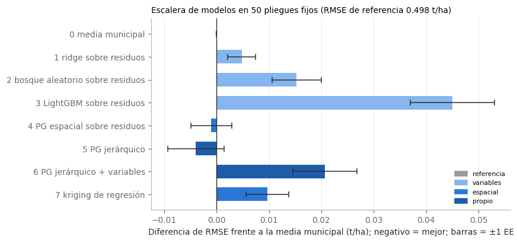
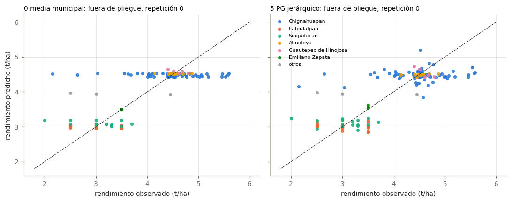
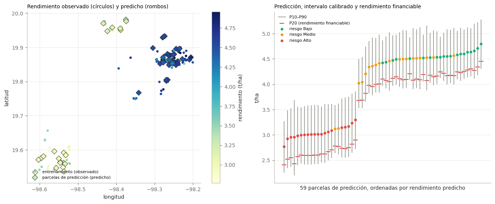
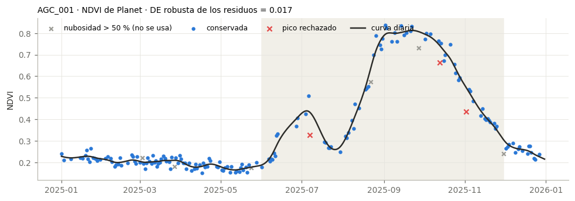
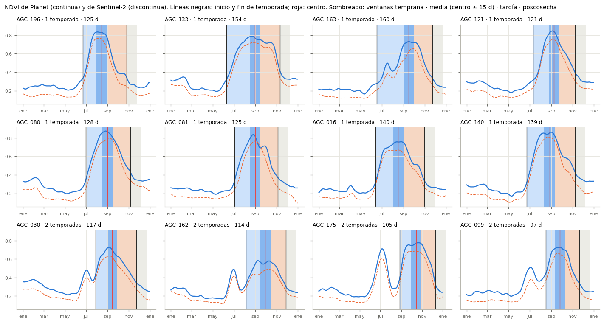
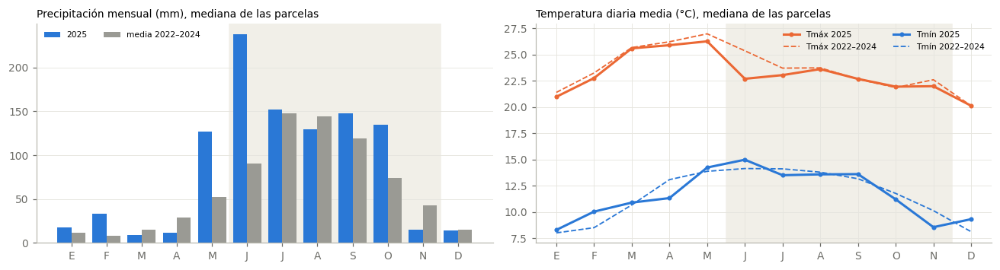
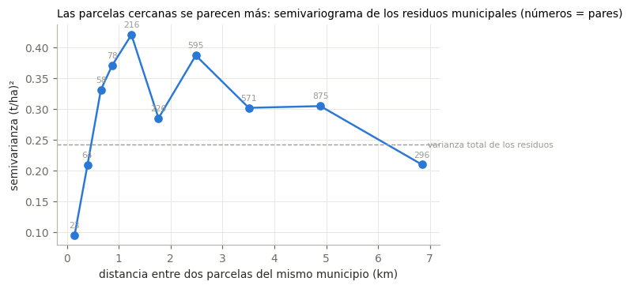
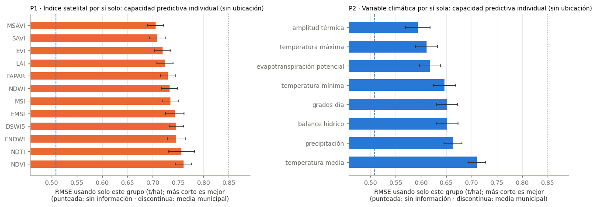

<p align="center"><a href="README.md">Español</a> | <b>English</b></p>

# Barley yield from satellite, climate and soil data — FIRA 2026 AgroCebada Challenge

**Team Mystical Circles**

This repository contains the complete code the team used to estimate barley yield (t/ha) for the 59 prediction plots of the FIRA 2026 AgroCebada Challenge, together with the uncertainty of each estimate. The pipeline starts from the original challenge data, cleans the PlanetScope, Sentinel-2 and Landsat satellite time series, extracts climate, terrain and soil data per polygon, compares ten models under a validation scheme fixed in advance, and delivers calibrated prediction intervals and a "financeable yield" (20th percentile) for each plot.

The final model is a **hierarchical Gaussian process** that combines a municipality effect with the spatial correlation between neighboring plots (at farm scale, ~0.3 km) and includes intervals calibrated through conformal prediction.

> The notebooks, outputs and figure labels are in Spanish.

## Main results

Stratified 5-fold cross-validation repeated 10 times (50 folds) on the 138 training plots:

| Model | RMSE (t/ha) | MAE (t/ha) | R² |
|---|---|---|---|
| Municipal mean (baseline) | 0.498 | 0.331 | 0.640 |
| **Hierarchical Gaussian process (final)** | **0.494** | 0.347 | **0.649** |

RMSE and MAE are averaged across folds; pooling all out-of-fold predictions, the final model's RMSE is 0.503 t/ha. The P10–P90 intervals covered 79.1 % of the observed yields (nominal: 80 %), and 79.5 % of the plots exceeded their P20 financeable yield. No satellite, climate or soil variable showed a signal above chance within each municipality (permutation test with 1,000 permutations). Details are in the technical report and in `qa/nb06_report.md` and `qa/nb07_report.md`, which are generated by the notebooks.

<p align="center">
  
</p>
<p align="center"><sub>Model comparison on the same 50 folds: RMSE difference relative to the municipal mean (negative = better). Notebook 06.</sub></p>

<p align="center">
  
</p>
<p align="center"><sub>Observed versus out-of-fold predicted yield: municipal mean (left) and hierarchical Gaussian process (right). Notebook 06.</sub></p>

The submitted predictions are in [`outputs/predicciones_finales.csv`](outputs/predicciones_finales.csv).

<p align="center">
  
</p>
<p align="center"><sub>Left: observed (circles) and predicted (diamonds) yield on the map. Right: prediction, P10–P90 interval and P20 financeable yield for the 59 plots, colored by risk level. Notebook 07.</sub></p>

The notebooks in `notebooks/` are published already executed in Google Colab, with their outputs and figures. That run reproduced the submitted prediction file byte for byte.

## Repository structure

```
.
├── README.md
├── requirements.txt           packages and versions used
├── notebooks/                 full pipeline, in execution order
│   ├── 01_setup_audit.ipynb
│   ├── 02_satellite_cleaning.ipynb
│   ├── 03_phenology_features.ipynb
│   ├── 04_climate_topography.ipynb
│   ├── 05_soils_master_folds.ipynb
│   ├── 06_models.ipynb
│   └── 07_final_predictions.ipynb
├── src/
│   └── agc_models.py          shared modeling code (written by notebook 06)
├── docs/
│   ├── sources.md             data sources and method references
│   └── figuras/               figures used in this README
└── outputs/
    ├── predicciones_finales.csv     the 59 prediction plots (submission)
    ├── predicciones_todas.csv       all 197 plots, for the web app
    ├── app_bundle/                  model parameters and guiding-question tables
    └── referencia/                  copy of the submitted predictions, to verify reproduction
```

Running the notebooks also creates the following folders, which are not included in the repository because they are regenerated: `raw/` (challenge data), `interim/`, `features/`, `models/`, `raw_external/` (soil data downloaded from SoilGrids) and `qa/` (reports, figures and checks from each notebook).

## Required data

The challenge data is provided by FIRA on the AgroCebada 2026 Challenge platform and is not redistributed here. Copy **all** the challenge files, unmodified, into `raw/`. Subfolders do not matter: notebook 01 locates each file by its content and detects duplicate copies.

| Challenge file or folder | Content |
|---|---|
| `ID_area_rendimiento_70_30_Reto_AgroCebada.csv` | identifier, area, yield and set (training or prediction) |
| `Parcelas_Reto_AGC_CONJUNTO.shp` (with `.dbf`, `.shx`, `.prj`, `.cpg`) | polygons of the 197 plots |
| `Conjunto_datos_PRO_AgroCebada.csv` | PlanetScope indices, 2025 |
| `Conjunto_datos_BASICO_AgroCebada2026.csv` | Sentinel-2 and Landsat indices, 2022–2025 |
| `Reto_AgroCebada_CHIRPS_Precipitacion_2022_2025/` | monthly precipitation (48 GeoTIFFs) |
| `Reto_AgroCebada_Temperatura_2022_2025/` | monthly minimum and maximum temperature (96 GeoTIFFs) |
| `Reto_AgroCebada_Topografia_INEGI_CEM4/` | elevation and slope at 120 m |

Soil properties are downloaded automatically from SoilGrids 2.0 (ISRIC) in notebook 05, so an internet connection is needed the first time. The tiles are saved in `raw_external/soilgrids/` and are not downloaded again.

## Reproducing the results

### In Google Colab (recommended)

1. Copy the contents of this repository to your Google Drive, in the folder `MyDrive/AgroCebada/`. The notebooks look for that path; if you use a different name, change the `BASE` variable in the configuration cell at the start of each notebook.
2. Copy the challenge data into `MyDrive/AgroCebada/raw/`.
3. Open the notebooks in Colab **in order, from 01 to 07**, and run each one completely (*Runtime → Run all*). A CPU is sufficient. Each notebook mounts Drive and checks that the outputs of the previous one exist; notebooks 01, 04 and 05 install the packages Colab does not include (`rasterio`, `pyogrio`, `owslib`).
4. After notebook 07 finishes, review the check *"Las predicciones reproducen las entregadas al reto"* (the predictions reproduce those submitted to the challenge): it compares the new predictions with `outputs/referencia/predicciones_finales_entregadas.csv` and must show `PASS`.

| Notebook | What it does | Approximate time |
|---|---|---|
| 01 | Audits the input files, plots and rasters; measures the location baseline | 3–6 min |
| 02 | Removes clouds and outliers and smooths each satellite index with a robust Whittaker filter | 5–10 min |
| 03 | Detects each plot's season and computes phenological, per-stage, uniformity and history features | 2–4 min |
| 04 | Extracts climate and terrain with exact area weighting per polygon, by crop stage | 2–4 min |
| 05 | Adds SoilGrids soil data, builds the master table, fixes the validation folds and measures the official baselines | 2–5 min |
| 06 | Trains and compares eight location-aware models on the same folds; writes `src/agc_models.py` | 10–15 min |
| 07 | Location-free models, ensemble, conformal intervals, guiding questions and final predictions | 10–15 min |

Each notebook writes a report to `qa/` (`qa/*_report.md`) with all its checks (PASS, WARN or FAIL) and its figures to `qa/figures/`. Every FAIL must be fixed before moving on to the next notebook; WARNs are explained in the report itself and do not block.

### On a local machine

Python 3.11 or later and Jupyter are required, because the notebooks use Jupyter commands (`!pip`, `%%writefile`).

```bash
pip install -r requirements.txt jupyterlab
export AGC_BASE=/path/to/this/repository      # folder containing raw/, notebooks/, src/…
jupyter lab
```

Run the notebooks in the same order. Outside Colab, each notebook reads the base folder from the `AGC_BASE` environment variable.

## Methodology overview

1. **Satellite time series.** For each sensor separately, images with cloud cover above a threshold are discarded and each index is smoothed on a daily grid with a robust Whittaker filter. The threshold and stiffness were chosen by hiding 10-day stretches of clear images and minimizing the reconstruction error (PlanetScope: ≤ 70 %, λ = 100; Sentinel-2: ≤ 10 %, λ = 100; Landsat: ≤ 30 %, λ = 10,000).
2. **Features.** Each plot's season is detected on its PlanetScope NDVI curve (amplitude-threshold method). Using those dates, 22 Sentinel-2 indices, PlanetScope EVI, LAI and MSAVI, and Landsat VI6T are summarized by crop stage. Climate (CHIRPS and CHIRTS-ERA5) and terrain (INEGI CEM 4.0) are extracted with exact area weighting per polygon; soil comes from SoilGrids 2.0, with available water estimated using Saxton and Rawls (2006). There are 268 features in total.
3. **Validation.** Before modeling, 10 repetitions of stratified 5-fold cross-validation and a secondary spatial-block validation were fixed. Every step that uses yield (feature selection, hyperparameters, municipality encoding) happens inside each fold.
4. **Models.** Municipal mean; ridge, random forest and LightGBM on municipal residuals; spatial Gaussian process; regression kriging; and a custom hierarchical Gaussian process, with and without features; plus two location-free models and a non-negative least squares ensemble.
5. **Uncertainty.** Intervals calibrated by conformal prediction on the standardized out-of-fold errors; the 20th percentile is reported as the financeable yield and defines three risk levels.

### The pipeline in figures

| | |
|---|---|
|  | **Satellite time series (notebook 02).** PlanetScope NDVI for one plot: retained observations, discarded cloudy images, rejected spikes and the smoothed daily curve. |
|  | **Phenology (notebook 03).** Season detected for each plot (start, center and end) and the crop's early, mid and late windows. |
|  | **Climate (notebook 04).** 2025 monthly precipitation and temperature compared with the 2022–2024 average: 2025 was an atypical year. |
|  | **Why a spatial model? (notebook 06).** Nearby plots within the same municipality are more alike: semivariance increases with distance. |
|  | **Guiding questions (notebook 07).** Stand-alone predictive skill of each satellite index and each climate variable, without location information. |

## Prediction file

`outputs/predicciones_finales.csv` has one row per prediction plot:

| Column | Description |
|---|---|
| `ID_POLIGONO` | plot identifier (AGC_001…AGC_197) |
| `Municipio`, `Estado` | municipality and state |
| `RENDIMIENTO_PRED_T_HA` | **predicted yield (t/ha); this is the submitted value** |
| `P10`, `P20`, `P80`, `P90` | percentiles of the calibrated interval (t/ha); `P20` is the financeable yield |
| `riesgo` | relative risk level (Bajo, Medio or Alto — low, medium or high), by terciles of the drop to P20 |
| `RENDIMIENTO_SATELITAL_T_HA` | prediction from a location-free model (satellite, climate, soil and terrain only), for reference |
| `dist_parcela_entrenamiento_km` | distance to the nearest training plot |

## Reproducibility

- All random seeds are fixed (`SEED = 42`) and the validation folds are saved in `models/cv_folds.json` and `models/cv_spatial.json`.
- Package versions are listed in `requirements.txt`; notebook 01 saves the full environment record to `qa/entorno_pip_freeze.txt`. If Colab changes its versions, there may be minimal numerical differences; the final check in notebook 07 measures them against the submitted predictions.
- No notebook modifies the files in `raw/`.

## Data sources

In addition to the challenge data, the pipeline uses CHIRPS (Funk et al., 2015), CHIRTS-ERA5 (Climate Hazards Center, 2025), the Mexican Elevation Continuum 4.0 (INEGI) and SoilGrids 2.0 (Poggio et al., 2021). Full references for data and methods are in [`docs/sources.md`](docs/sources.md).

## Related repositories

The project is split into two repositories. Both are linked at the end of chapter 2 of the website
(section "¿Quieres ver cómo lo hicimos?").

- **Website (this repository):** [github.com/Hyatxs/AgroCebada-Modular](https://github.com/Hyatxs/AgroCebada-Modular)
- **Predictive model:** [github.com/Valoo-1201/AgroCebada-Modelo](https://github.com/Valoo-1201/AgroCebada-Modelo).
  It contains the notebooks that produce the site's figures (NB03 phenology, NB04 climate, NB07 final model).

## Team

Equipo Representativo STEM · UDLAP · Lourdes María García Garfias | María Valentina García Hernández | Dana Paola Sánchez Alonso | Dulce Grecia Pérez Capilla | Lizeth Bonilla Díaz
